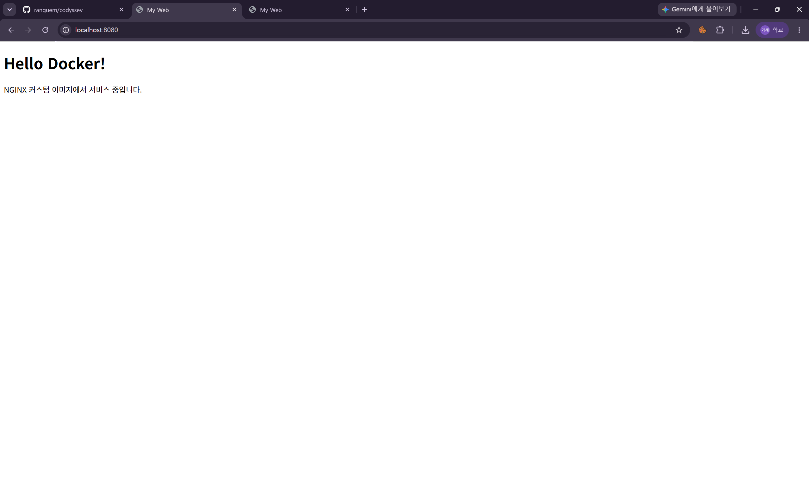
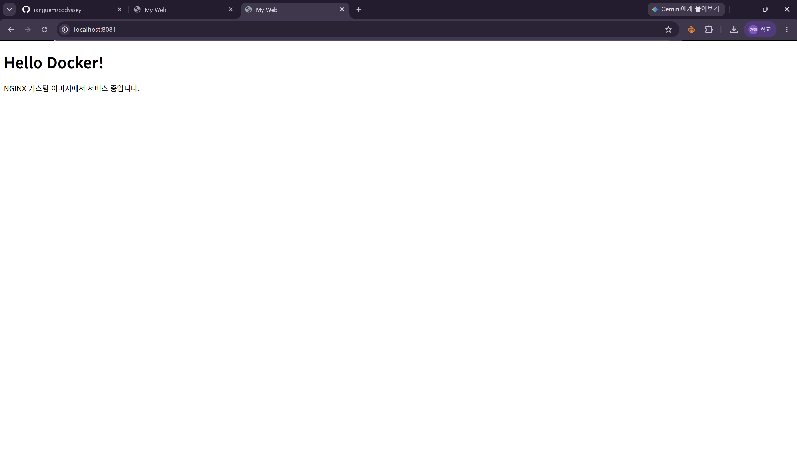

# 개발 워크스테이션 구축 미션

터미널(Linux CLI), Docker, Git/GitHub를 직접 세팅하고, 실행 결과(로그·접속·데이터 유지)로 검증한 기록입니다.

## 1) 프로젝트 개요

- **목표:** "내 컴퓨터에서만 돌아가는" 문제를 줄이고, 누구나 같은 방식으로 실행·배포·디버깅할 수 있는 개발 환경을 만든다.
- **수행 내용:** 터미널로 작업 디렉토리/권한 정리 → Docker 설치·점검 → 컨테이너 실행/관리 → Dockerfile로 웹 서버 컨테이너화 → 포트 매핑 → 바인드 마운트/볼륨 검증 → Git/GitHub 연동
- **구성:**
  - `my-web/` : NGINX 기반 커스텀 이미지 (Dockerfile, `site/index.html`)
  - `images/` : 스크린샷 증거
  - `README.md` : 수행 로그와 설명

## 2) 실행 환경

| 항목 | 내용 |
|---|---|
| OS | Windows 11 + WSL2 (Ubuntu 26.04.1 LTS, resolute) |
| Shell / Terminal | bash (Windows Terminal에서 WSL Ubuntu 실행) |
| Docker | Docker version 29.9.3, build 5457199 (Docker Desktop 4.99.0, WSL2 백엔드) |
| Git | git version 2.53.0 (WSL) |
| Editor | VSCode |

> **재현 시 주의:** Windows에서는 Docker Desktop + WSL2(Ubuntu)가 필요합니다. 서울캠퍼스(macOS)는 OrbStack을 쓰면 동일한 `docker` 명령으로 진행할 수 있습니다. 실습 파일은 WSL 홈(`~`)에서 작업한 뒤 저장소로 복사했습니다.

## 3) 수행 체크리스트

- [x] 터미널 기본 조작 및 폴더 구성
- [x] 권한 변경 실습 (파일 1개, 디렉토리 1개)
- [x] Docker 설치/점검 (`docker --version`, `docker info`)
- [x] Docker 기본 운영 명령 (pull / images / ps / logs / stats)
- [x] hello-world / ubuntu 컨테이너 실행
- [x] attach / exec 차이 관찰
- [x] Dockerfile 기반 커스텀 이미지 빌드/실행
- [x] 포트 매핑 접속 (8080, 8081 총 2회)
- [x] 바인드 마운트 반영 (8082)
- [x] 볼륨 영속성
- [ ] Git 설정 + VSCode GitHub 연동 (스크린샷 첨부 필요)
- [ ] (보너스) Docker Compose / 환경변수 / SSH 키

## 4) 수행 로그

### 4-1. 터미널 조작

작업 위치: WSL 홈(`/home/prkgp`). 현재 위치 확인, 숨김 파일 포함 목록, 생성, 이동, 복사, 이름 변경, 삭제, 내용 확인을 수행했습니다.

```bash
$ cd ~
$ pwd
/home/prkgp
$ ls -la
total 28
drwxr-x--- 4 prkgp prkgp 4096 Nov 13 19:26 .
drwxr-xr-x 3 root  root  4096 Nov 13 19:21 ..
-rw-r--r-- 1 prkgp prkgp  220 Nov 13 19:21 .bash_logout
-rw-r--r-- 1 prkgp prkgp 3771 Nov 13 19:21 .bashrc
...
$ mkdir -p codyssey-practice/docs
$ cd codyssey-practice
$ pwd
/home/prkgp/codyssey-practice
$ touch empty.txt                 # 빈 파일 생성
$ echo "hello" > note.txt         # 내용 있는 파일 생성
$ cat note.txt                    # 파일 내용 확인
hello
$ ls -la
drwxr-xr-x 3 prkgp prkgp 4096 Nov 13 20:09 .
drwxr-x--- 5 prkgp prkgp 4096 Nov 13 20:09 ..
drwxr-xr-x 2 prkgp prkgp 4096 Nov 13 20:09 docs
-rw-r--r-- 1 prkgp prkgp    0 Nov 13 20:09 empty.txt
-rw-r--r-- 1 prkgp prkgp    6 Nov 13 20:09 note.txt
$ cp note.txt note_copy.txt       # 복사
$ mv note_copy.txt renamed.txt    # 이름 변경
$ mv renamed.txt docs/            # 이동
$ ls -R
.:
docs  empty.txt  note.txt

./docs:
renamed.txt
$ rm empty.txt                    # 삭제
$ ls -la
drwxr-xr-x 3 prkgp prkgp 4096 Nov 13 20:11 .
drwxr-x--- 5 prkgp prkgp 4096 Nov 13 20:09 ..
drwxr-xr-x 2 prkgp prkgp 4096 Nov 13 20:10 docs
-rw-r--r-- 1 prkgp prkgp    6 Nov 13 20:09 note.txt
```

### 4-2. 권한 실습 (변경 전/후 비교)

```bash
# 파일
$ ls -l note.txt
-rw-r--r-- 1 prkgp prkgp 6 Nov 13 20:09 note.txt     # 변경 전 (644)
$ chmod 600 note.txt
$ ls -l note.txt
-rw------- 1 prkgp prkgp 6 Nov 13 20:09 note.txt     # 변경 후 (600)

# 디렉토리
$ ls -ld docs
drwxr-xr-x 2 prkgp prkgp 4096 Nov 13 20:10 docs      # 변경 전 (755)
$ chmod 700 docs
$ ls -ld docs
drwx------ 2 prkgp prkgp 4096 Nov 13 20:10 docs      # 변경 후 (700)

# 디렉토리 삭제
$ rm -r docs
$ ls -la
drwxr-xr-x 2 prkgp prkgp 4096 Nov 13 20:12 .
drwxr-x--- 5 prkgp prkgp 4096 Nov 13 20:09 ..
-rw------- 1 prkgp prkgp    6 Nov 13 20:09 note.txt
```

### 4-3. Docker 설치/점검

```bash
$ docker --version
Docker version 29.9.3, build 5457199
$ git --version
git version 2.53.0
$ docker info
Client:
 Version:    29.9.3
 ...
Server Version: 29.9.3
Storage Driver: overlayfs
Kernel Version: 6.18.58.1-microsoft-standard-WSL2
Operating System: Docker Desktop
OSType: linux
Architecture: x86_64
...
```

`docker info`에 Server 정보가 출력되어 데몬이 정상 동작함을 확인했습니다. (전체 출력은 `images/` 스크린샷 참고)

### 4-4. Docker 기본 운영 명령

```bash
$ docker pull nginx:alpine
alpine: Pulling from library/nginx
...
Status: Downloaded newer image for nginx:alpine
$ docker images
IMAGE          ID             DISK USAGE   CONTENT SIZE
nginx:alpine   713fc2ebfd92   94.5MB       27.3MB

$ docker run hello-world
Hello from Docker!
This message shows that your installation appears to be working correctly.
...

$ docker run -it --name ubuntu-test ubuntu bash
root@260e486b968c:/# ls
bin  boot  dev  etc  home  lib  lib64  media  mnt  opt  proc  root  run  sbin  srv  sys  tmp  usr  var
root@260e486b968c:/# echo "hi from container"
hi from container
root@260e486b968c:/# exit

$ docker ps
CONTAINER ID   IMAGE   COMMAND   CREATED   STATUS   PORTS   NAMES
$ docker ps -a
CONTAINER ID   IMAGE         COMMAND    CREATED          STATUS                     NAMES
260e486b968c   ubuntu        "bash"     30 seconds ago   Exited (0) 13 seconds ago  ubuntu-test
9b8008ff6ef9   hello-world   "/hello"   58 seconds ago   Exited (0) 56 seconds ago  hardcore_maxwell
$ docker logs ubuntu-test
(컨테이너 안에서 입력한 ls, echo 내용이 그대로 기록됨)
```

`docker stats`는 **실행 중인 컨테이너만** 보여주기 때문에, 처음에는 출력이 비어 있었습니다. 백그라운드 컨테이너를 띄운 뒤 다시 확인했습니다.

```bash
$ docker run -d --name ubuntu-bg ubuntu sleep infinity
$ docker stats --no-stream
CONTAINER ID   NAME        CPU %   MEM USAGE / LIMIT     MEM %   NET I/O         BLOCK I/O     PIDS
293609b1ab6f   ubuntu-bg   0.00%   3.809MiB / 3.672GiB   0.10%   1.17kB / 126B   18.6MB / 0B   1
```

#### attach vs exec 관찰

```bash
$ docker exec -it ubuntu-bg bash
root@293609b1ab6f:/# exit
$ docker ps
...  ubuntu-bg   Up 31 seconds        # exec로 들어갔다 나와도 컨테이너 유지

$ docker run -dit --name ubuntu-attach ubuntu bash
$ docker attach ubuntu-attach
root@2e60c41794cf:/# exit
$ docker ps -a
...  ubuntu-attach   Exited (127)     # attach 후 exit → 메인 프로세스(bash) 종료 → 컨테이너 종료
...  ubuntu-bg       Up 2 minutes
```

| | `docker exec` | `docker attach` |
|---|---|---|
| 동작 | 실행 중인 컨테이너에 **새 프로세스**를 추가로 실행 | 컨테이너의 **메인 프로세스(PID 1)** 에 연결 |
| `exit` 후 | 컨테이너 **유지** | 메인 프로세스가 끝나므로 컨테이너도 **종료** |

> 종료 코드가 127인 이유: attach 중에 컨테이너 안에서 입력한 마지막 명령(`docker ps -a`)이 `command not found`(코드 127)였고, `exit`가 그 코드를 그대로 반환했기 때문입니다.

### 4-5. Dockerfile 커스텀 이미지 / 포트 매핑

**선택한 방식:** (A) 웹 서버 베이스 이미지(NGINX) + 정적 콘텐츠 교체

**베이스 이미지:** `nginx:alpine` (가볍고 정적 파일 서비스에 적합)

`my-web/Dockerfile`

```dockerfile
FROM nginx:alpine
LABEL org.opencontainers.image.title="my-custom-nginx"
ENV APP_ENV=dev
COPY site/ /usr/share/nginx/html/
```

| 커스텀 포인트 | 목적 |
|---|---|
| `FROM nginx:alpine` | 검증된 웹 서버 이미지를 재사용해 직접 만들 부분을 최소화 |
| `LABEL` | 이미지 메타데이터(이름) 기록 |
| `ENV APP_ENV=dev` | 실행 모드를 환경 변수로 주입 (설정과 코드의 분리 맛보기) |
| `COPY site/ ...` | 기본 NGINX 페이지를 내가 만든 `index.html`로 교체 |

```bash
$ docker build -t my-web:1.0 .
[+] Building 2.1s (7/7) FINISHED
 => [2/2] COPY site/ /usr/share/nginx/html/
 => => naming to docker.io/library/my-web:1.0

$ docker run -d -p 8080:80 --name my-web-8080 my-web:1.0
$ curl http://localhost:8080
<!DOCTYPE html>
<html lang="ko">
<head><meta charset="UTF-8"><title>My Web</title></head>
<body>
 <h1>Hello Docker!</h1>
<p>NGINX 커스텀 이미지에서 서비스 중입니다.</p>
</body>
</html>

$ docker run -d -p 8081:80 --name my-web-8081 my-web:1.0
$ curl http://localhost:8081
(동일한 HTML 응답)

$ docker ps
IMAGE        PORTS                                         NAMES
my-web:1.0   0.0.0.0:8081->80/tcp, [::]:8081->80/tcp      my-web-8081
my-web:1.0   0.0.0.0:8080->80/tcp, [::]:8080->80/tcp      my-web-8080

$ docker inspect my-web:1.0 --format '{{json .Config.Labels}} {{json .Config.Env}}'
{"maintainer":"NGINX Docker Maintainers ...","org.opencontainers.image.title":"my-custom-nginx"} [... "APP_ENV=dev"]
```

**브라우저 접속 증거 (주소창 포함)**






### 4-6. 바인드 마운트 (변경 반영)

```bash
$ docker run -d -p 8082:80 --name bind-test -v "$(pwd)/site":/usr/share/nginx/html my-web:1.0
$ curl http://localhost:8082            # 변경 전
<!DOCTYPE html>
...
 <h1>Hello Docker!</h1>
...

$ echo "<h1>변경됨: 바인드 마운트</h1>" > site/index.html     # 호스트에서 수정
$ curl http://localhost:8082            # 변경 후 (컨테이너 재시작 없음)
<h1>변경됨: 바인드 마운트</h1>

$ docker inspect bind-test --format '{{json .Mounts}}'
[{"Type":"bind","Source":"/home/prkgp/my-web/site","Destination":"/usr/share/nginx/html","Mode":"","RW":true,"Propagation":"rprivate"}]
```

> 이 실험 때문에 `my-web/site/index.html`의 내용이 "변경됨"으로 바뀌어 있습니다. (실험 결과)

### 4-7. Docker 볼륨 영속성

```bash
$ docker volume create mydata
mydata
$ docker run -d --name vol-test -v mydata:/data ubuntu sleep infinity
$ docker exec vol-test bash -c "echo hi > /data/hello.txt && cat /data/hello.txt"
hi                                      # 삭제 전
$ docker rm -f vol-test                 # 컨테이너 삭제
vol-test

$ docker run -d --name vol-test2 -v mydata:/data ubuntu sleep infinity
$ docker exec vol-test2 cat /data/hello.txt
hi                                      # 삭제 후에도 데이터 유지
$ docker volume ls
DRIVER    VOLUME NAME
local     mydata
```

### 4-8. Git / GitHub 연동

```bash
$ git config --global user.name "박가혜"
$ git config --global user.email "<마스킹>"
$ git config --global init.defaultBranch main
$ git config --list
...
user.name=박가혜
user.email=***@***
init.defaultbranch=main
...
remote.origin.url=https://github.com/ranguem/codyssey.git
branch.main.remote=origin
branch.main.merge=refs/heads/main
```

- 저장소 생성 → `git clone` → README 수정 → `git add / commit / push` 성공 (push 시 브라우저 인증으로 GitHub 로그인)
- VSCode GitHub 로그인 / 저장소 연동 스크린샷:


> 스크린샷에 이메일, 토큰, 인증 코드가 보이면 반드시 가린 뒤 첨부하세요.

## 5) 트러블슈팅

### ① `git: 'cofig' is not a git command`

| 단계 | 내용 |
|---|---|
| 문제 | `git cofig --global.name ...` 입력 시 오류 |
| 원인 가설 | 명령어 오타 |
| 확인 | 에러 메시지의 "The most similar command is config" |
| 해결 | `git config --global user.name "..."` 으로 수정 |

### ② WSL에 Ubuntu 배포판이 없음 / 권한 상승 필요

| 단계 | 내용 |
|---|---|
| 문제 | `wsl -l -v` 결과가 "설치된 배포가 없습니다", `wsl --install -d Ubuntu`는 "권한 상승이 필요합니다" |
| 원인 가설 | WSL 본체만 설치되었고, 배포판 설치에는 관리자 권한과 재부팅이 필요 |
| 확인 | `wsl -l -v` 결과, 오류 메시지 |
| 해결 | 재부팅 후 **관리자 권한 PowerShell**에서 `wsl --install -d Ubuntu` 실행 → 유저 생성 완료 |

### ③ `docker build` 실패: `unknown instruction: >`

| 단계 | 내용 |
|---|---|
| 문제 | `dockerfile parse error on line 2: unknown instruction: >` |
| 원인 가설 | 파일 내용이 잘못 들어감 (heredoc 입력 중 `>` 프롬프트 문자가 섞임) |
| 확인 | `cat Dockerfile`에서 `> FROM nginx:alpine` 줄이 중복으로 존재 |
| 해결 | `printf`로 Dockerfile을 다시 작성 → 재빌드 성공. 이미지가 없어서 `docker run`/`curl`도 함께 실패했던 것이므로 원인은 하나 |

### ④ 컨테이너 안에서 `docker: command not found`

| 단계 | 내용 |
|---|---|
| 문제 | `docker attach` 후 `docker ps -a` 입력 시 `bash: docker: command not found` |
| 원인 가설 | 컨테이너 안에는 docker가 설치되어 있지 않음 |
| 확인 | 프롬프트가 `root@<컨테이너ID>:/#` 형태 → 컨테이너 내부 |
| 해결 | `exit`로 호스트로 복귀한 뒤 실행 |

### ⑤ `permission denied while trying to connect to the docker API`

| 단계 | 내용 |
|---|---|
| 문제 | 기존 터미널 탭에서 `docker rm -f ...` 실행 시 `/var/run/docker.sock` 권한 오류 |
| 원인 가설 | Docker Desktop WSL 연동을 켜기 **전에** 열어둔 오래된 터미널 세션 |
| 확인 | 새로 연 탭에서는 같은 `docker` 명령이 정상 동작 |
| 해결 | 터미널 탭을 새로 열고 `wsl -d Ubuntu`로 재진입 (필요하면 `wsl --shutdown` 후 Docker Desktop 재시작) |

## 6) 개념 정리

**절대 경로 vs 상대 경로**
- 절대 경로: 루트(`/`)부터 시작하는 전체 경로. 어디서 실행해도 같은 위치. 예: `/home/prkgp/codyssey-practice/note.txt`
- 상대 경로: 현재 위치 기준. 예: 현재 위치가 `/home/prkgp`일 때 `./codyssey-practice/note.txt`, 한 단계 위는 `../`

**파일 권한 (r/w/x, 755/644)**
- r=읽기(4), w=쓰기(2), x=실행(1). 소유자/그룹/기타 순서로 3자리 숫자의 합으로 표기
- 755 = 소유자 rwx(7) / 그룹 r-x(5) / 기타 r-x(5)
- 644 = 소유자 rw-(6) / 그룹 r--(4) / 기타 r--(4)
- 실습: `note.txt` 644→600, `docs` 755→700

**커스텀 이미지**
- 이미지(설계도)를 베이스로 `FROM`하고 `COPY`, `ENV`, `LABEL` 등을 얹어 나만의 이미지를 만든다. 이미지는 읽기 전용 템플릿이고 컨테이너는 그것을 실행한 인스턴스라서, 같은 이미지로 컨테이너를 여러 개 띄워도 같은 환경이 재현된다. (8080, 8081 동시 실행으로 확인)

**포트 매핑이 필요한 이유**
- 컨테이너는 격리된 네트워크를 쓰므로 호스트에서 바로 접근할 수 없다. `-p 호스트포트:컨테이너포트`로 호스트의 포트를 컨테이너의 포트에 연결해야 외부(브라우저)에서 접속할 수 있다. 예: `-p 8080:80`

**Docker 볼륨(영속 데이터)**
- 컨테이너 파일시스템은 컨테이너를 삭제하면 함께 사라진다. 볼륨은 컨테이너 밖에서 Docker가 관리하는 저장소라서 컨테이너를 삭제해도 데이터가 남고, 새 컨테이너에 다시 연결할 수 있다. (`mydata` 볼륨의 `hello.txt` 유지 확인)
- 참고: 바인드 마운트는 호스트의 특정 폴더를 그대로 연결해 "변경 반영"에 적합하고, 볼륨은 Docker가 관리해 "데이터 보존"에 적합하다.

**Git vs GitHub**
- Git: 내 컴퓨터에서 변경 이력을 관리하는 로컬 버전 관리 도구
- GitHub: Git 저장소를 원격에 호스팅하고 협업(push/pull, 공유, 리뷰)하게 해주는 플랫폼

## 7) 보안 점검

- [ ] 이메일, 토큰, 비밀번호, 인증 코드가 문서/스크린샷에 없는지 확인
- [ ] `git config --list` 출력의 이메일 마스킹 확인
